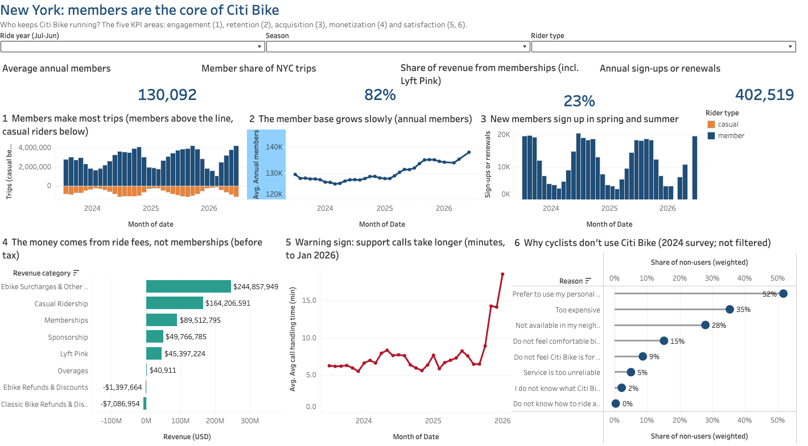
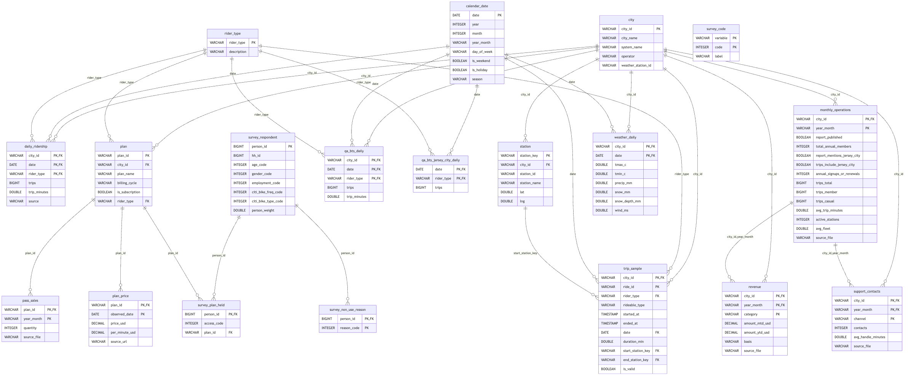
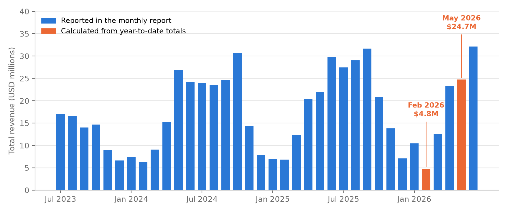

# Citi Bike vs Divvy: what keeps bike-share subscribers riding?

[](https://github.com/omerfarukersin/citibike-subscription-analysis/actions/workflows/ci.yml)

An end-to-end analytics project on 146 million bike-share trips in New York and Chicago: six public sources, a
DuckDB relational model, SQL KPIs, automated quality checks and a Tableau dashboard generated from Python.

Main result: members are the stable base in bad weather and winter, but e-bike fees, not memberships, are now
New York's largest revenue line.

**Stack:** Python (pandas, DuckDB, pypdf, tableauhyperapi) · SQL · Tableau

---

## At a glance

**Business question:** What drives subscription engagement in bike share (price, city, weather)? Citi Bike (New York)
vs Divvy (Chicago), July 2023 to June 2026.

**Headline findings**

- **Members are the stable base.** On heavy-rain days (20+ mm) New York casual trips run 44% below a dry day,
  member trips 37%, after adjusting for month and weekday. Chicago: 35% and 29%.
- **Winter separates the two rider types.** Chicago casual riding drops to 10-13% of its summer level; members keep
  29-36%. In New York, casual riders keep 15-28%, members 39-57%.
- **New York keeps more subscribers despite a higher price.** Members make 81-83% of New York trips every year vs
  64-65% in Chicago, although New York's annual plan costs $205-$239 against Chicago's $143.90.
- **The money comes from ride fees, not memberships.** Of New York's $221.1M revenue before tax (Jul 2025 - Jun 2026),
  46% is e-bike per-minute charges and other fees, and only about 23% is memberships (incl. Lyft Pink), while members
  make about 83% of trips (ride year Jul 2025 - Jun 2026).

**What I'd recommend to the operator** (associations, so each should be tested before money is spent):

1. **Grow from new riders rather than converting casual riders.** Casual fees bring about $7.32 per casual trip
   against $1.35 of membership fees per member trip (Jul 2025 - Jun 2026; e-bike fees are not split by rider type,
   so they are left out of both). Converting a casual rider to a member would lower revenue per trip. Among cyclists
   who don't use Citi Bike, 35% say it is too expensive and 28% that there is no station nearby: entry pricing and
   coverage are the levers.
2. **Clear docks quickly after snow.** In New York's 2025-26 winter, the 31 dry days with snow still on the ground
   lost slightly more trips in total than the 13 snowfall days (about 298,000 vs 281,000 below normal).
3. **Plan for warm winter days.** On the 23 dry winter days at least 8 °C warmer than usual for the month (19 of
   them in Chicago), casual riding ran at about 1.8 times a normal day and member riding about 1.4 times.

Definitions and queries: [`sql/analysis/recommendation_checks.sql`](sql/analysis/recommendation_checks.sql).
Caveat on point 1: report revenue includes Jersey City and Hoboken from March 2025, while the trip counts are
New York only, so both per-trip figures are overstated by up to about 2.5%; the roughly fivefold gap is unchanged.



**Live dashboard:** [Tableau Public](https://public.tableau.com/app/profile/omer.faruk.ersin/viz/citibike_story_17924625377670/1NewYork)
(4 tabs: New York, NYC vs Chicago, Weather, Stations). The same packaged workbook is in the repo:
[`tableau/citibike_story.twbx`](tableau/citibike_story.twbx). Screenshots of every tab:
[`tableau/story_preview/`](tableau/story_preview/).

---

## Architecture

```mermaid
flowchart LR
    subgraph S[Public sources]
        A1[Citi Bike + Divvy<br/>trip files]
        A2[Citi Bike monthly<br/>operating reports PDF]
        A3[Pricing pages<br/>+ Wayback snapshots]
        A4[BTS daily<br/>ridership]
        A5[NOAA GHCN-Daily<br/>weather]
        A6[NYC DOT Mobility<br/>Survey 2024]
    end
    S --> B[Python extract<br/>download, PDF regex,<br/>HTML parsing]
    B --> C[Staging<br/>Parquet / CSV]
    C --> D[(DuckDB<br/>19 tables, 28 FKs, 3NF)]
    D --> E[SQL views<br/>KPIs + H1-H4]
    D --> F[QA views<br/>cross-source checks]
    E --> G[CSV marts<br/>16 files]
    F --> Q[qa/*.csv]
    G --> H[Tableau workbook<br/>generated from Python<br/>Hyper extracts + XML]
    H --> I[Tableau Public<br/>+ packaged .twbx]
```



| Stage | Code | Output |
|---|---|---|
| Download | `src/download_trips.py`, `src/download_reports.py`, `src/ingest_sources.py` | raw files, staged Parquet |
| Extract | `src/extract_reports.py` (regex over PDF text), `src/extract_pricing.py` | `data/staging/*.csv` |
| Load | `src/load.py` + `sql/schema.sql` | `citibike.duckdb` |
| Analyse | `src/analyze.py` + `sql/kpis/*.sql` (14 files) + `sql/qa_checks.sql` | `data/marts/*.csv`, `qa/*.csv` |
| Document | `src/docs.py` | `docs/data_dictionary.md`, `docs/erd.mmd` |
| Visualise | `tableau/build_story.py` | `tableau/citibike_story.twbx` |

---

## Data sources

All public and free. Six source types, logged as 10 entries (one per file series or page) with URLs, access dates
and the sanity check for each in [`docs/source_log.csv`](docs/source_log.csv). Licence details and attribution:
[`DATA_SOURCES.md`](DATA_SOURCES.md).

| Source | Publisher | What it gives | Period used | Terms |
|---|---|---|---|---|
| Citi Bike and Divvy trip history | Lyft Bikes and Scooters, LLC (operator of Citi Bike and Divvy) | trip-level records, stations, bike type | Chicago: all 36 months (daily totals) and four sample months (trip detail). New York: four sample months (Jul 2025, Oct 2025, Jan 2026, Apr 2026) | Citi Bike Data License Agreement (on the "Data Sharing Policy" page); Divvy Data License Agreement |
| Citi Bike monthly operating reports | Citi Bike (Lyft) to NYC DOT | members, sign-ups, trips, revenue by category, support calls | 34 published months (Feb and May 2026 not published) | public reports; revenue preliminary and unaudited |
| Pricing pages (live + Wayback Machine) and the 2026 Citi Bike price notice | Citi Bike, Divvy, Internet Archive | plan prices | snapshots 2023-08 to 2026-10, plus the Jan 2026 price notice | official price lists |
| Docked Bikeshare Ridership (New York, Chicago and Jersey City series) | U.S. DOT Bureau of Transportation Statistics | daily trips by city and rider type | Jul 2023 - Jun 2026 | U.S. government work, public domain |
| GHCN-Daily | NOAA NCEI | daily temperature, rain, snow, snow depth (Central Park, O'Hare) | Jul 2023 - Jun 2026 | U.S. government work, public domain |
| Citywide Mobility Survey - Person 2024 | NYC Department of Transportation, via NYC Open Data | weighted survey: plan used, frequency, reasons for not using | 2024 (8,569 respondents) | NYC.gov Terms of Use |

Trip files are anonymised (no rider ID).

---

## Data model



- **19 tables, 28 foreign keys**, defined in [`sql/schema.sql`](sql/schema.sql). Column-level documentation with
  row counts is generated from the live database: [`docs/data_dictionary.md`](docs/data_dictionary.md).
- **Third normal form for the source and fact tables.** Each fact sits at its natural grain with a composite
  primary key: `daily_ridership` (city, date, rider type), `revenue` (city, month, category), `plan_price` (plan,
  observed date), `support_contacts` (city, month, channel). Attributes that depend on something else live in their
  own table: plan names and billing cycles in `plan`, survey labels in `survey_code`, station names and coordinates
  in `station`. `calendar_date` is a deliberately denormalised date dimension (month, season, weekday and holiday
  flags on one row per date), the usual design for a date table. One known compromise: `survey_plan_held` stores
  both the survey's access code and the `plan_id` it maps to, a transitive dependency kept for simpler joins.
- **Prices are observations, not assumptions.** `plan_price` stores what a page showed on a snapshot date. The
  one exact change date comes from Citi Bike's official notice ($239/year from 28 Jan 2026).
- **Cross-check tables are kept apart** (`qa_bts_daily`, `qa_bts_jersey_city_daily`) so the analysis tables hold
  one trusted source per fact, and the alternatives stay available for QA.
- `trip_sample` holds 17.4M trips from the sample months; `daily_ridership` holds every day for both cities.

---

## Data quality: problems found and fixed

Every number in the reports and PDFs was checked against a second source where one exists. Four problems
changed how the data had to be used.

### 1. BTS double-counted Chicago in January 2026

The federal BTS series is the obvious source for daily trips. For Chicago in January 2026 it reports 266,184 trips;
Divvy's own trip files contain 133,107. That is **+99.98%**, a double count. The other 35 months agree within
0.02%. **Fix:** Chicago ridership is built from Divvy's trip files for all 36 months; BTS is kept only as a check
([`qa/qa_chi_files_vs_bts.csv`](qa/qa_chi_files_vs_bts.csv)).

### 2. Citi Bike's reports quietly changed scope in March 2025

Report trip totals sat 0.07-0.29% above BTS New York until February 2025, then jumped to 2.5-2.8% above. Pulling
the BTS series for Citi Bike's Jersey City system explained it: from March 2025, BTS New York + Jersey City matches the
report within 0.7%. The reports started counting Jersey City and Hoboken, with no note in the text.
**Fix:** New York trends use BTS New York only, so the series is consistent across the whole window. Ratios built
on report totals (trips per member, calls per 100 trips) are flagged.


### 3. Two monthly reports were never published

The February and May 2026 operating reports do not exist on Citi Bike's site. Members, sign-ups and support
figures for those months are left NULL. Revenue is different: each report carries a year-to-date column, so a missing
month equals the next report's year-to-date total minus the previous one. That is exact arithmetic, not an estimate
($4.5M for February and $22.9M for May before tax; $4.8M and $24.7M including tax), and the rows are flagged
`basis = 'derived_from_ytd'`. The same arithmetic gives 295 year-to-date cross-checks over 31 months; Citi Bike's
own later revisions (> $1) appear in 7 of them, so a derived month may carry such a correction
([`qa/revenue_ytd_checks.csv`](qa/revenue_ytd_checks.csv)). That is why May 2026 shows a sponsorship line of
-$384k: the June report's year-to-date sponsorship total, less June itself, is $384k lower than the April report's
year-to-date total. That points to a later restatement of an earlier month, and the YTD method assigns any such
restatement to the missing month. It is a property of the method, not an extraction error.



### 4. The trip sample is validated against the full count

Only four New York months were downloaded as trip files (one per season); BTS already gives every day split by member
and casual. The sample matches BTS within 0.1% for every city, month and rider type (largest gap 0.05%), apart from
the Chicago January 2026 double count above ([`qa/qa_sample_vs_bts.csv`](qa/qa_sample_vs_bts.csv)). This kept the
download to the sample months while still covering every day in the analysis.

**Also checked:** every non-NULL value extracted from the 34 PDFs appears verbatim in its source text; revenue
categories sum to the reported total in all 34 months; member + casual = total trips in every month; trip validity
rules (99.5% of New York sample trips and 96.6% of Chicago trips pass). A separate source-by-source audit that
re-read the raw PDFs, HTML and CSVs against the database is in [`qa/qa_report.md`](qa/qa_report.md), with the issues
it raised and how each was fixed.

---

## Methods

**Normal-day baseline.** Each day's trips are divided by the average for the same city, rider type, month and
weekday/weekend type, with holidays excluded from the average. A ratio of 0.80 means 20% fewer trips than a
comparable normal day, so the weather comparison is not confused with season or day of week
([`sql/kpis/11_h1_weather_sensitivity.sql`](sql/kpis/11_h1_weather_sensitivity.sql)).

All weather, price and city results are **associations, not causes**.

---

## Findings

| | Hypothesis | Verdict | Evidence |
|---|---|---|---|
| H1 | Casual riders are more weather-sensitive than members | Supported | Heavy rain vs a dry day (both on the normal-day ratio): NYC casual -44%, member -37%; Chicago -35% / -29%. Snow day vs a winter day without snow: NYC -42% / -34%, Chicago -22% / -14%. |
| H2 | The winter drop is deeper in Chicago, and members hold up better | Supported | Winter as a share of summer daily trips: Chicago casual 10-13%, members 29-36%; NYC casual 15-28%, members 39-57%. |
| H3 | Member share differs between cities | Supported; price alone does not explain it | NYC 81.0% / 81.8% / 82.6% by ride year vs Chicago 64.7% / 64.0% / 64.9%, while NYC's annual plan costs more. A single NYC ride is a flat $4.49-$4.99; Chicago charges $1 + $0.18-0.20 per minute, so short casual rides are cheaper there. |
| H4 | E-bike use differs by rider type | Supported | Share of trips on e-bikes (sample months): NYC casual 77.5% vs members 70.5%; Chicago 71.2% vs 65.7%. |

**Revenue.** In the 12 months to June 2026, New York revenue before tax was $221.1M. E-bike per-minute charges and
other fees were the largest line ($101.7M, 46%), then single rides and day passes ($57.8M), memberships ($32.4M) and
Lyft Pink ($18.2M). Casual fees come to about $7.32 per casual trip against $1.35 of membership revenue per member
trip (e-bike fees are not split by rider type, so they are left out of both). Report revenue includes Jersey City
and Hoboken from March 2025 while the trip counts are New York only, so both per-trip figures are overstated by up
to about 2.5%.


**Trip length.** Median trip in the sample months: NYC members 8.3 min, casual 12.5 min; Chicago 8.7 / 11.3 min.

**Customer service.** Average call handling time rose from about 6 minutes in 2023 to a peak of 18.6 minutes in
January 2026, then eased to 10.9 minutes by June 2026.


Full results, KPI tables and caveats: [`docs/findings.md`](docs/findings.md).

---

## Repository structure

```
.
├── Makefile                 pipeline entry points (setup, all, and each stage)
├── LICENSE                  MIT (code)
├── DATA_SOURCES.md          data licences and attribution
├── requirements.txt         pinned Python dependencies
├── requirements-dev.txt     adds pytest and ruff
├── pyproject.toml           ruff and pytest settings
├── .github/workflows/ci.yml CI: lint, compile, tests, Tableau build from the marts (no downloads)
├── src/                     Python: download, extract, load, analyse, docs
├── sql/
│   ├── schema.sql           19 tables, primary and foreign keys
│   ├── kpis/                14 files: KPI views and hypotheses H1-H4
│   ├── qa_checks.sql        cross-source checks
│   └── analysis/            ad-hoc checks behind the recommendations (not part of make)
├── data/
│   ├── marts/               16 Tableau-ready CSVs (small, committed)
│   ├── reference/           prices extracted from the saved pricing pages
│   └── raw/                 downloads (only the report index and survey dictionary are committed)
├── qa/                      QA results (CSV) and the audit report
├── tests/                   pytest: PDF parsing, YTD derivation, schema + views on an empty DB, QA outputs
├── tableau/
│   ├── build_story.py       generates the workbook (Hyper extracts + XML)
│   ├── citibike_story.twbx  packaged workbook, 4 tabs
│   └── story_preview/       screenshots of each tab
└── docs/
    ├── findings.md          full findings and data notes
    ├── data_dictionary.md   every table and column
    ├── erd.png, erd.mmd     data model
    ├── source_log.csv       sources, URLs, access dates, sanity checks
    ├── project_report.pdf   4-page project report (start here)
    ├── Findings_Report.pdf  hypothesis results in more detail (LaTeX source alongside)
    ├── KPI_Report.pdf       KPI framework: definitions and results by category (LaTeX source alongside)
    ├── Tableau_Data_Guide.pdf  mart reference: what each CSV holds and which dashboard tab uses it
    ├── chart_*.py           scripts for the charts in docs/img/
    └── img/                 charts used in this README and the report
```

---

## Quick start: view the results (1 minute, nothing to install)

- **Dashboard:** view it live on [Tableau Public](https://public.tableau.com/app/profile/omer.faruk.ersin/viz/citibike_story_17924625377670/1NewYork), or open
  [`tableau/citibike_story.twbx`](tableau/citibike_story.twbx) in Tableau Desktop or the free Tableau Public app
  (2024.2 or newer). The data is packaged inside.
- **Data:** the 16 CSVs in [`data/marts/`](data/marts/) open in Excel, pandas or any BI tool.
- **Report:** [`docs/project_report.pdf`](docs/project_report.pdf).

## Rebuild the dashboard from the CSVs (2 minutes, no database, no Tableau needed)

```bash
make setup      # Python 3.11+; installs the pinned packages into .venv
make tableau    # data/marts/*.csv -> tableau/citibike_story.twbx
```

## Tests and lint (no database or downloads needed)

```bash
make test       # 15 pytest tests: PDF parsing, YTD derivation, schema + all views on an empty DuckDB, QA outputs
make lint       # ruff
make help       # list every target
```

The same checks run in GitHub Actions on every push, plus a rebuild of the Tableau workbook from the marts.

## Full rebuild from the public sources (about 30-60 minutes)

Needs Python 3.11+, `make`, about **3.2 GB of downloads** and **8 GB of free disk**. Tested on macOS (Apple
silicon). The database (`citibike.duckdb`, about 2.6 GB) and the staged trip files are not committed; `make all`
recreates them.

```bash
make setup
make all        # download -> ingest -> extract -> load -> analyze -> docs -> tableau
```

| Step | What it does | Download | Time |
|---|---|---|---|
| `make download` | 4 Citi Bike + 36 Divvy monthly trip files -> Parquet; 34 operating-report PDFs | 3.1 GB + 94 MB | bandwidth-bound |
| `make ingest` | BTS daily ridership (API), NOAA weather, NYC mobility survey | about 40 MB | under 1 min |
| `make extract` | regex extraction from the report PDFs; prices | none | seconds |
| `make load` | builds `citibike.duckdb` (19 tables, 28 foreign keys) | none | about 80 s |
| `make analyze` | KPI, hypothesis and QA views -> `data/marts/*.csv`, `qa/*.csv` | none | seconds |
| `make docs` | `docs/data_dictionary.md`, `docs/erd.mmd` | none | seconds |
| `make tableau` | the packaged Tableau workbook | none | seconds |

A clean rebuild reproduces the committed marts (byte-for-byte apart from float rounding in station coordinates).
The inputs are frozen at the access date, 13 October 2026, so the results do not drift as the operators publish
new data: `data/raw/reports/report_index.csv` fixes the set of 34 reports (a report published later, such as
February 2026, is ignored), and the prices extracted from the saved pricing pages are kept in
[`data/reference/plan_price_observations.csv`](data/reference/plan_price_observations.csv).

Query the database directly:

```bash
.venv/bin/python -c "import duckdb; print(duckdb.connect('citibike.duckdb', read_only=True).sql('SELECT * FROM h3_city_comparison'))"
```

---

## Limitations

- **No customer IDs**, so churn, cohorts and lifetime value cannot be measured. The reports combine new sign-ups and
  renewals; net membership growth is used instead.
- **Trip-level detail comes from four sample months** (one per season). Daily totals cover every day.
- **Revenue is preliminary and unaudited**, as stated in Citi Bike's reports, and is not split by rider type.
- **One weather station per city** (Central Park, O'Hare), so local conditions across each city are not captured.
- The survey's Citi Bike questions were asked only of adults who cycle (about 34% of adults).
- Prices come from snapshots; exact change dates are known only for the January 2026 New York increase.

---

## Tools

Python (pandas, DuckDB, pypdf, requests, tableauhyperapi), SQL (DuckDB), Tableau, Mermaid, Make.
Developed with Claude Code as an AI coding assistant.

## Author

**Omer Faruk Ersin**, MSc student, Trinity Business School, Trinity College Dublin

Built for the BU7141 Data Management & Visualisation module, Trinity Business School (Oct 2026).
