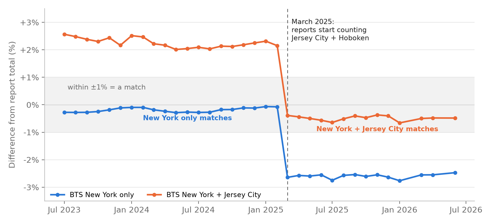
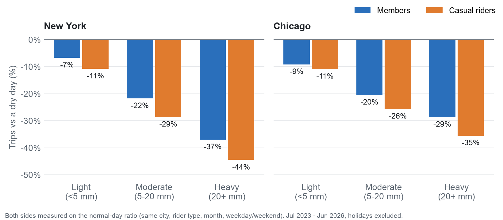
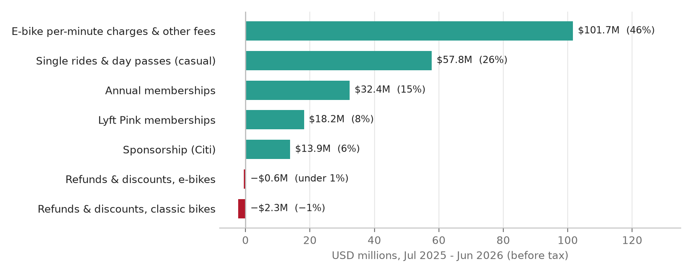

*Built for the BU7141 Data Management & Visualisation module, Trinity Business School. Code and data model: see
the repository README. Live dashboard: [Tableau Public](https://public.tableau.com/app/profile/omer.faruk.ersin/viz/citibike_story_17924625377670/1NewYork).*

# 1. Problem

Bike share in large US cities runs on two kinds of customers: members, who pay an annual fee, and casual riders, who
pay per ride or per day. I wanted to know what drives subscription engagement, and in particular how price, city
and weather relate to how much members and casual riders ride. I compared Citi Bike in New York with Divvy in
Chicago. Both are operated by Lyft, so differences between them are more likely to reflect the cities and the
pricing than the operator.

I tested four hypotheses:

- **H1:** casual riders are more weather-sensitive than members;
- **H2:** the winter drop is deeper in Chicago, and members hold up better;
- **H3:** member share differs between the cities;
- **H4:** e-bike use differs by rider type.

# 2. Data

I used six public source types covering July 2023 to June 2026 (10 entries in `docs/source_log.csv`):

| Source | Used for |
|---|---|
| Citi Bike and Divvy trip files | trip length, stations, bike type: four sample months in both cities; all 36 Chicago months for daily totals |
| Citi Bike monthly operating reports (34 PDFs) | members, sign-ups, revenue by category, support calls |
| Citi Bike and Divvy pricing pages, Wayback Machine snapshots and the 2026 price notice | plan prices |
| U.S. Bureau of Transportation Statistics, daily bike-share ridership (New York, Chicago, Jersey City) | every New York day, split by member and casual; cross-checks |
| NOAA GHCN-Daily (Central Park, O'Hare) | temperature, rain, snowfall, snow depth |
| NYC DOT Citywide Mobility Survey 2024 (8,569 respondents) | plan used, frequency, reasons for not using |

In total the analysis covers 129.2 million New York trips and 16.7 million Chicago trips.

# 3. Pipeline

The pipeline is Python and SQL, run end to end with `make all`:

1. **Download and extract.** Python scripts download the trip files and reports. Figures are pulled from the
   report PDFs with pypdf and regular expressions, and prices from the saved pricing pages. Anything not found stays
   NULL and is listed in an issues file.
2. **Stage and load.** Cleaned data is written to Parquet/CSV and loaded into a DuckDB database.
3. **Analyse.** 14 SQL files define the KPI and hypothesis views. Separate QA views compare each source with a
   second one.
4. **Publish.** The views are exported to 16 CSV marts. A Python script builds the Tableau workbook directly
   (Hyper extracts plus workbook XML), so the four-tab dashboard can be regenerated from code.

# 4. Data model

The database has **19 tables and 28 foreign keys** in third normal form. Facts are stored at their natural grain:
daily trips by city, date and rider type; revenue by city, month and category; prices by plan and observation
date. Plans, stations and survey labels sit in their own lookup tables; `calendar_date` is a deliberately
denormalised date dimension (month, season, weekday and holiday flags on one row per date). Prices are stored as
observations on a snapshot date rather than assumed change dates. Cross-check sources are kept in separate
`qa_*` tables, so each analysis table has one trusted source.

# 5. Data quality

Four problems changed how the data had to be used:

- **BTS double-counted Chicago in January 2026.** BTS reports 266,184 trips; Divvy's own files contain 133,107
  (+99.98%). The other 35 months agree within 0.02%. I built Chicago ridership from Divvy's files instead.
- **Citi Bike's reports changed scope in March 2025.** Report totals jumped from 0.07-0.29% above BTS New York
  to 2.5-2.8% above. Adding BTS's Jersey City series closed the gap to within 0.7%: the reports had started
  counting Jersey City and Hoboken. New York trends therefore use BTS New York only.
- **Two monthly reports were never published (February and May 2026).** I left members, sign-ups and support
  figures blank. Revenue could be recovered exactly from the year-to-date columns of the neighbouring reports
  ($4.5M and $22.9M before tax), and those rows are flagged as derived. 295 year-to-date cross-checks over 31 months
  show Citi Bike's own later revisions (> \$1) in 7 of them, so a derived month may include such a correction. This is why
  May 2026 shows a sponsorship line of -$384k: a later restatement lands in the missing month by construction.
- **The trip sample matches the full count.** The four New York sample months match BTS within 0.1% for every
  rider type, which justified downloading a seasonal sample instead of every month.

{width=62%}

# 6. Findings

To separate weather from season, each day's trips are compared with a **normal day**: the average for the same
city, rider type, month and weekday/weekend type, with holidays excluded. All results are associations, not causes.

**H1, supported.** On heavy-rain days (20+ mm), New York casual trips run 44% below a dry day and member trips 37%
below, both measured on the normal-day ratio; in Chicago 35% and 29%. On snow days, New York casual riding is 42%
below a winter day without snow and member riding 34%.

**H2, supported.** Winter (Dec-Feb) daily trips as a share of summer (Jun-Aug): Chicago casual riders 10-13%,
members 29-36%; New York casual riders 15-28%, members 39-57%.

{width=80%}

**H3, supported, but price alone does not explain it.** Members make 81-83% of New York trips each year against
64-65% in Chicago, even though New York's annual plan is dearer ($205 rising to $239, vs $143.90). A New York single
ride costs a flat $4.49-$4.99, while Chicago charges $1 plus $0.18-0.20 per minute, so short casual rides are cheaper
in Chicago, which may weaken the incentive to subscribe (not tested).

**H4, supported.** In the sample months, 77.5% of New York casual trips were on e-bikes against 70.5% of member
trips (Chicago 71.2% vs 65.7%).

**Revenue.** New York revenue before tax was $221.1M in the 12 months to June 2026. The largest line is e-bike
per-minute charges and other fees ($101.7M, 46%). Memberships and Lyft Pink together bring in about 23%, although
members make about 83% of trips (same ride year).

{width=64%}

# 7. Recommendations for the operator

These apply the same normal-day method to questions the hypotheses raised. They are associations and should be
tested before money is spent on them. Queries and definitions: `sql/analysis/recommendation_checks.sql`.

1. **Grow from new riders rather than converting casual riders.** Casual fees bring in about $7.32 per casual trip
   against $1.35 of membership fees (Memberships plus Lyft Pink) per member trip, roughly five times more (e-bike
   fees are not split by rider type and are left out of both). Converting casual riders to members would lower
   revenue per trip. In the 2024 survey, 35% of cyclists who do not use Citi Bike said it is too expensive and 28%
   that it is not available near them, which points to entry pricing and coverage as ways to reach new riders.
   Report revenue includes Jersey City and Hoboken from March 2025 while the trip counts are New York only, so both
   per-trip figures are overstated by up to about 2.5%; the gap between them is unchanged.
2. **Clear docks quickly after snow.** In New York in winter 2025-26 there were 13 snowfall days and 31 dry days
   (under 1 mm of precipitation) with snow still on the ground. Each snowfall day was worse (56% of normal riding
   vs 82%), but because there were more of them, the dry days with lying snow lost slightly more trips in total:
   about 298,000 below normal against about 281,000. Snow clearance after the storm matters as much as
   operations during it.
3. **Plan for warm winter days.** On dry winter days at least 8 °C warmer than the city's usual maximum for the
   month (23 such days across both cities, 19 of them in Chicago), casual riding was about 1.8 times a normal day
   and member riding about 1.4 times. These days can be seen in the forecast. Having bikes rebalanced near parks and
   inviting lapsed riders back on those days targets the riders who respond most.

# 8. Limitations

- There are no customer IDs in public data, so churn, cohorts and lifetime value cannot be measured. The reports
  combine new sign-ups and renewals, so I used net membership growth instead.
- Trip-level detail (trip length, e-bike share, stations) comes from four sample months, one per season.
- Revenue is preliminary and unaudited, as Citi Bike states, and is not split by rider type.
- Each city has one weather station (Central Park, O'Hare), which cannot capture local conditions.
- The normal-day baseline for a month includes that month's bad-weather days, so the estimates of lost trips in the
  recommendations are approximate.
- The survey's Citi Bike questions were asked only of adults who cycle (about 34% of adults).

# 9. What I would do next

- With customer-level data: cohorts, churn and lifetime value, which public data cannot support.
- An A/B test of the single-ride price, to test the association between pricing and member share.
- More weather stations per city, so local conditions and borough-level effects can be tested.
